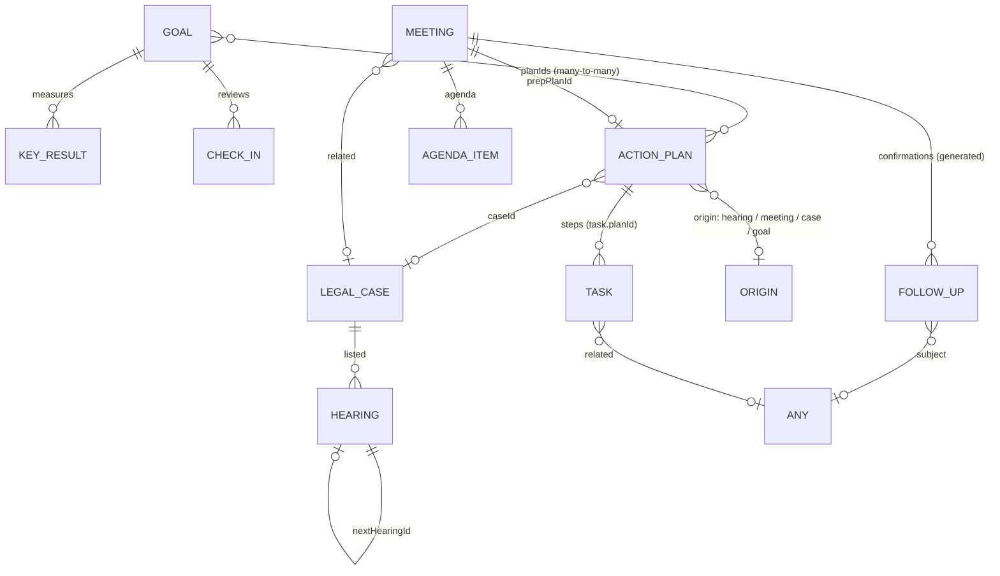

# Domain model

Stiamo models a practitioner's working life across four **workspaces**: Personal, **S&B Consultants** (legal), **FSA** (tech) and **Media duties**. Everything lives in `src/domain` and has no dependency on React, storage or the browser.

## Connections, history and files

Records are connected in two ways, and both feed a **thread** you can open from any record:

- **Structural** relations the system creates: plan → steps, case → hearings, hearing → next hearing, case/hearing/meeting → action plan, meeting → preparation plan, goal → plans, any record → the task or follow-up spawned as its further action.
- **Links** you make by hand between any two records (`Link`), e.g. one case with every meeting held about it.

`RelationGraph.thread(ref)` returns the ancestors ("part of"), the descendant tree, and the hand-linked peers. Deleting a record removes its links.

Every create, update, outcome, rescheduling, link and file change writes an **Activity** (with a field-by-field change set). A record's history is the merged activity of its whole thread, plus notes you add. Free-form notes are Activity too.

**Attachments** belong to any record (`owner`) — tasks, follow-ups, meetings, cases, individual hearings, plans, goals. Metadata lives with the data; bytes go through the `FileStore` port (Supabase Storage, or IndexedDB offline).

**Follow-ups** don't need a date: `due` is optional (anytime / on a day / at a time).

**Plan pages** keep a `doc` (block-editor JSON) alongside the tracked steps; drawings inside it are stored as attachments.

## Outcome — the core idea

Nothing is just "completed". Tasks, follow-ups, meetings, hearings and agenda items all carry an **Outcome**:

| Status | Meaning | Task | Follow-up | Meeting | Hearing | Agenda item |
| --- | --- | --- | --- | --- | --- | --- |
| `open` | not yet recorded | Open | Open | Open | Open | Open |
| `done` | achieved | Done | Reached | Held | Proceeded | Covered |
| `partial` | partly achieved | Partly done | Left message | Partly covered | Part-heard | Partly covered |
| `not_done` | didn't happen | Not done | No answer | Didn't happen | Adjourned | Not covered |
| `cancelled` | no longer relevant | Cancelled | Cancelled | Cancelled | Cancelled | Dropped |

Each outcome can carry a **comment** and a **further action**. When you record an outcome, the further action can be created on the spot as a linked **task** (which stays in the same action plan) or **follow-up** (`RecordOutcomeUseCase`).

Progress anywhere is computed from outcomes: done = 1, partial = 0.5, not done = 0, cancelled is excluded (`progressOf`).

## Aggregates

### Task
General work in any workspace. Has a priority, an optional due date, an estimate, and an optional planned **slot** on a day. A task can be a **step of an action plan** (`planId`, `order`) and can point to where it came from (`related`: a meeting, hearing, follow-up…).

### Meeting (appointments and meetings)
Appointments and meetings are the same kind of thing — a timed engagement with people — so they share one model. `kind` decides the workflow:

- **Appointment** — booked with a client or outside party. It needs **confirmation**: follow-up calls the **day before** (at the same clock time, kept within 09:00–19:00) and/or the **hour before**. These follow-ups are generated and kept in sync automatically (`syncConfirmations`): moving the appointment moves open confirmations, turning one off removes it, cancelling the appointment removes open ones, and logged confirmations are never touched.
- **Meeting** — agenda-driven. It has an **agenda** (topics with owner, minutes, notes and their own outcome), an optional **preparation plan**, minutes, and an overall outcome.

Both have a mode (in person / virtual / phone), location or link, counterpart, contact, attendees, and can relate to a legal case.

### Follow-up
A call, message, email or visit to make, due on a date (optionally at a time), about a subject (any record). Confirmation follow-ups carry `trigger: 'day_before' | 'hour_before'`.

A follow-up is a **chase**: `attempts` records every try (`date`, `minute`, `result`: `no_answer | left_message | call_back | they_will_call | not_ready | reached | unreachable`, optional note, `promisedFor`). `FollowUpUseCases.logAttempt` appends a try and re-dates the follow-up from `suggestRetry` (domain/followups/chase.ts) unless the caller supplies the next try; `reached` closes it as done, `unreachable` clears the date, anything else leaves it open. `chaseOf` derives where it stands (fresh, chasing, waiting, promised, stalled after three misses, unreachable) and `bestMinute` the time of day a contact last picked up. Nothing about the chase is stored besides the attempts and the new `due`.

### Legal case & hearing
Cases are filed on behalf of an **organization**: NUMW (National Union for Migrant Workers), TUMWU (Telangana Unorganized and Migrant Workers Union), PMLU (Palamooru Migrant Labour Union), MRC (Migrants Rights Council), TYP (The Youth Project) or SA (Samrat & Associates).

**Case numbers are generated, never typed**: `{ORG}-{YYYY}-{NNN}`, e.g. `TUMWU-2026-004`. The year is the filing year (today's when no filing date is given) and the count carries on from the highest number already used for that organization and year, so deleting a case never reuses a number. The court's own number is kept separately as the optional *court number*.

Each case has a **type**:

| Type | Meaning |
| --- | --- |
| PoW Case | unpaid or delayed wages — Payment of Wages Act |
| Public Interest Case | filed for a wider group or cause, not one individual |
| Industrial Disputes Case | termination, retrenchment, settlements — Industrial Disputes Act |
| MW Case | pay below the notified rate — Minimum Wages Act |
| Workmen Compensation Case | compensation for injury or death at work |
| Other | anything else |

**Who handles it.** Most cases are handled by us. When one isn't, the case carries an **engagement** — the outside counsel briefed, when, the scope of the brief, whether it's pro bono or the agreed fee, and notes. No engagement means we handle it. Assigning, changing or taking a brief back is written to the history of both the case and the counsel (`CaseUseCases.assignCounsel`).

### Counsel
The directory of outside **advocates and law firms** we know: contact details, city, the courts they appear before, the kinds of case they're good for, whether they take pro bono matters, and notes. Their page lists every case they're briefed on with the terms of each, plus documents (fee agreements, vakalatnamas) and a thread that includes those cases. Removing counsel returns their cases to us.

A **case** also has an optional client (or group, for a PIL), opposing party, court, practice area, stage, status and a running **summary**. **Hearings** are listed against it. Recording a hearing (`CaseUseCases.recordHearing`) is one step that:

1. writes the hearing **summary** and **outcome** (proceeded / part-heard / adjourned / cancelled),
2. lists the **next hearing** (date, time, purpose) and links it (`nextHearingId`),
3. creates the **action plan for the next stage** with its steps as tasks, due by the next date,
4. updates the case's stage and status.

Past hearings without an outcome are flagged everywhere until written up.

### Action plan
An objective with ordered **steps**. A step is a task, a follow-up or an appointment (`StepKind`): each is its own record carrying `planId` and `order`, and each has its own due day (`PlanStep.date`; for an appointment its slot's day), whatever the plan's `dueDate` is. `planSteps(planId, pool)` reads them as one list, `planProgress` counts all three, and `PlanUseCases.addStep` / `setStepDate` / `reorderSteps` work across kinds. A new step starts from the plan's date (`StepDraft.dueDate` omitted), has its own day when given, or none when `null`; `setDueDate` changes the plan's date and moves the open steps that were still on the old one. `convertStep` turns one kind into another and keeps the **same id**, plan, place, day, notes and outcome — so a hearing action's `taskId` (which really means "the step made for this action") and hand-made links still point at it. Plans record their **origin** (hearing, meeting, case or goal), may belong to a case, and can contribute to **several goals**. Deleting a plan keeps its steps as standalone tasks.

A plan's **coverage** says what it applies to. `caseIds` and `hearingIds` are lists: one plan can serve several cases and several hearings, as one page with one set of steps. The scope is derived — *general* (nothing), *case-wide* (cases, no hearings), *specific hearings*, or *one task* (`taskId`, exclusive of the others). `PlanUseCases.cover` adds a case, hearing (which brings its case) or task and `uncover` removes one (dropping a case drops its hearings; dropping a hearing keeps the case). In the thread the plan hangs under each of its hearings and under cases not reached through a hearing. `duplicate` makes an independent copy (same page and steps, all open, covering nothing). Deleting a case only detaches that case from shared plans.

Plans saved before this carried single `caseId` / `hearingId`; `planCaseIds` / `planHearingIds` read both and `normalizePlan` rewrites them into the lists on save. The plan created when a hearing is written up covers the *next* hearing.

A plan's page is written as questions, answers and insights (`question`, `answer` and `insight` blocks). `digestOf` reads them back: a question is **answered** once an answer with text follows it, **parked** if set aside, otherwise **open**; insights can each become a step.

### Case diary = the hearing record
A `Hearing` carries its own write-up, so the case diary is a view over recorded hearings (`diaryOf`, `isDiaryEntry`), not a second entity: `summary`, `bench`, `order`, `submissions`, `authorities[]`, `evidence`, `reflections` and **`actions[]`** — each `{ id, text, due?, taskId? }`. The next date and what it is listed for are the `nextHearingId` hearing's own date and purpose.

**One hearing, several cases.** `caseId` is the main case and `alsoCaseIds` the other cases heard together with it (`hearingCaseIds` lists all of them). `hearingsOf(caseId)` includes shared hearings; the graph puts the hearing under each case; a plan made from it covers every case; the next hearing created when it is recorded inherits the same cases. `CaseUseCases.joinCases` sets the list: it folds in same-day, unwritten listings of the added cases (`mergeCandidates`), moving plans, `nextHearingId` pointers, attachments, tasks and follow-ups across, and `saveHearing` / `recordHearing` (`alsoCaseIds`) use it. Deleting a case deletes hearings that were only about it, and otherwise promotes another of the hearing's cases to main. `caseUpdate` (stage, status) applies to the main case.

`CaseUseCases.recordHearing` writes everything in one go: when a plan is requested without typed steps, the hearing's actions *are* the steps, created in order with their own due dates (default: the plan's date), and each action is stamped with the `taskId` of the task made for it. Passing `notes` replaces the write-up (anything left out is cleared); omitting it leaves what is there. `HearingActionUseCases.toTasks` makes standalone tasks on the case for actions with no task; `toPlan` makes an action plan from them (covering all the hearing's cases, and the next hearing when it is open). An action is *closed* once its task is (`actionClosed`, `pendingActions`). `searchDiary` matches every word of a query across the record and the cases it concerns.

### Client & project (FSA)
A **client** (`kind` company or individual, contact, status) and its **projects** (`clientId`, status, dates). They are tied to work through the existing `related` pointer: a meeting, appointment or task whose `related` is a client or a project belongs to it. `clientRefKeys` / `meetingsFor` / `tasksFor` gather a client's work (the client itself plus all its projects); `clientOf` finds the client behind a reference. In the thread a project sits under its client and work sits under its project or client. Deleting a client (`ClientUseCases.remove`) deletes its projects; meetings and tasks stay, untied.

### Goal
The long view. A goal has a horizon, a start and target date, **key results** (from → target, current), **linked action plans** and periodic **check-ins** (confidence 1–5 + note).

`goalProgress` blends key-result progress and linked-plan progress equally, then compares it with the share of time elapsed to derive **health**:

| Lag (time elapsed − progress) | Health |
| --- | --- |
| ≤ 0.10 | On track |
| ≤ 0.25 | At risk |
| > 0.25 | Off track |

## Agenda (read model)

`buildAgenda` turns tasks, meetings, follow-ups and hearings into uniform **AgendaEntries** for any date range. The calendar and the day planner work only on entries. Entries know whether they are:

- **pinned** — fixed in time; reflow flows around them (meetings, hearings, confirmation calls),
- **movable** — can be dragged (everything except hearings, whose time is set by the court).

`AgendaUseCases.schedule` maps a drag back onto the right record (a task's slot, a follow-up's time, a meeting's slot — re-syncing confirmations) and returns a snapshot for undo.

## Planner

`dayPlan.ts` holds the pure planning logic: overlap detection, side-by-side column layout, 15-minute snapping, and **packDay** — the reflow algorithm. It packs flexible blocks back-to-back from a start time in their current order, flowing around pinned, closed and already-finished blocks, optionally fitting unplanned work into what's left.
