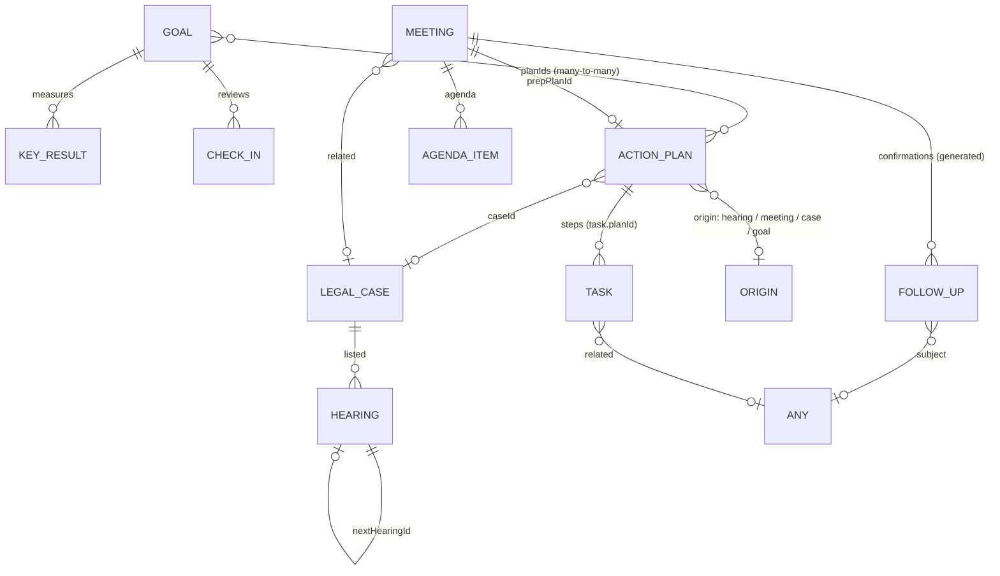

# Domain model

Stiamo models a practitioner's working life across four **workspaces**: Personal, **S&B Consultants** (legal), **FSA** (tech) and **Media duties**. Everything lives in `src/domain` and has no dependency on React, storage or the browser.

## Connections, history and files

Records are connected in two ways, and both feed a **thread** you can open from any record:

- **Structural** relations the system creates: plan → steps, case → hearings, hearing → next hearing, case/hearing/meeting → action plan, meeting → preparation plan, goal → plans, any record → the task or follow-up spawned as its further action.
- **Links** you make by hand between any two records (`Link`), e.g. one case with every meeting held about it.

`RelationGraph.thread(ref)` returns the ancestors ("part of"), the descendant tree, and the hand-linked peers. Deleting a record removes its links.

Every create, update, outcome, rescheduling, link and file change writes an **Activity** (with a field-by-field change set). A record's history is the merged activity of its whole thread, plus notes you add. Free-form notes are Activity too.

**Attachments** belong to any record (`owner`) — tasks, follow-ups, meetings, cases, individual hearings, plans, goals. Metadata lives with the data; bytes go through the `FileStore` port (Supabase Storage, or IndexedDB offline).

**Follow-ups** don't need a date: `due` is optional (anytime / on a day / at a time).

**Plan pages** keep a `doc` (block-editor JSON) alongside the tracked steps; drawings inside it are stored as attachments.

## Outcome — the core idea

Nothing is just "completed". Tasks, follow-ups, meetings, hearings and agenda items all carry an **Outcome**:

| Status | Meaning | Task | Follow-up | Meeting | Hearing | Agenda item |
| --- | --- | --- | --- | --- | --- | --- |
| `open` | not yet recorded | Open | Open | Open | Open | Open |
| `done` | achieved | Done | Reached | Held | Proceeded | Covered |
| `partial` | partly achieved | Partly done | Left message | Partly covered | Part-heard | Partly covered |
| `not_done` | didn't happen | Not done | No answer | Didn't happen | Adjourned | Not covered |
| `cancelled` | no longer relevant | Cancelled | Cancelled | Cancelled | Cancelled | Dropped |

Each outcome can carry a **comment** and a **further action**. When you record an outcome, the further action can be created on the spot as a linked **task** (which stays in the same action plan) or **follow-up** (`RecordOutcomeUseCase`).

Progress anywhere is computed from outcomes: done = 1, partial = 0.5, not done = 0, cancelled is excluded (`progressOf`).

## Aggregates

### Task
General work in any workspace. Has a priority, an optional due date, an estimate, and an optional planned **slot** on a day. A task can be a **step of an action plan** (`planId`, `order`) and can point to where it came from (`related`: a meeting, hearing, follow-up…).

### Meeting (appointments and meetings)
Appointments and meetings are the same kind of thing — a timed engagement with people — so they share one model. `kind` decides the workflow:

- **Appointment** — booked with a client or outside party. It needs **confirmation**: follow-up calls the **day before** (at the same clock time, kept within 09:00–19:00) and/or the **hour before**. These follow-ups are generated and kept in sync automatically (`syncConfirmations`): moving the appointment moves open confirmations, turning one off removes it, cancelling the appointment removes open ones, and logged confirmations are never touched.
- **Meeting** — agenda-driven. It has an **agenda** (topics with owner, minutes, notes and their own outcome), an optional **preparation plan**, minutes, and an overall outcome.

Both have a mode (in person / virtual / phone), location or link, counterpart, contact, attendees, and can relate to a legal case.

### Follow-up
A call, message, email or visit to make, due on a date (optionally at a time), about a subject (any record). Confirmation follow-ups carry `trigger: 'day_before' | 'hour_before'`.

### Legal case & hearing (S&B)
A **case** has a reference number, client, opposing party, court, practice area, stage, status and a running **summary**. **Hearings** are listed against it. Recording a hearing (`CaseUseCases.recordHearing`) is one step that:

1. writes the hearing **summary** and **outcome** (proceeded / part-heard / adjourned / cancelled),
2. lists the **next hearing** (date, time, purpose) and links it (`nextHearingId`),
3. creates the **action plan for the next stage** with its steps as tasks, due by the next date,
4. updates the case's stage and status.

Past hearings without an outcome are flagged everywhere until written up.

### Action plan
An objective with ordered **steps** (tasks). Plans record their **origin** (hearing, meeting, case or goal), may belong to a case, and can contribute to **several goals**. Deleting a plan keeps its steps as standalone tasks.

### Goal
The long view. A goal has a horizon, a start and target date, **key results** (from → target, current), **linked action plans** and periodic **check-ins** (confidence 1–5 + note).

`goalProgress` blends key-result progress and linked-plan progress equally, then compares it with the share of time elapsed to derive **health**:

| Lag (time elapsed − progress) | Health |
| --- | --- |
| ≤ 0.10 | On track |
| ≤ 0.25 | At risk |
| > 0.25 | Off track |

## Agenda (read model)

`buildAgenda` turns tasks, meetings, follow-ups and hearings into uniform **AgendaEntries** for any date range. The calendar and the day planner work only on entries. Entries know whether they are:

- **pinned** — fixed in time; reflow flows around them (meetings, hearings, confirmation calls),
- **movable** — can be dragged (everything except hearings, whose time is set by the court).

`AgendaUseCases.schedule` maps a drag back onto the right record (a task's slot, a follow-up's time, a meeting's slot — re-syncing confirmations) and returns a snapshot for undo.

## Planner

`dayPlan.ts` holds the pure planning logic: overlap detection, side-by-side column layout, 15-minute snapping, and **packDay** — the reflow algorithm. It packs flexible blocks back-to-back from a start time in their current order, flowing around pinned, closed and already-finished blocks, optionally fitting unplanned work into what's left.
